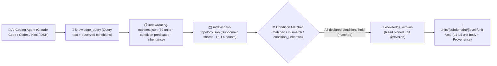

<p align="center">
  
</p>

<h1 align="center">MindIE Agent Knowledge — Distributed Inference & Collectives Corpus (<code>knowledge-infer-distributed</code>)</h1>

<p align="center">
  <strong>Graded L1–L4 engineering knowledge corpus for Ascend distributed inference & collectives: covering HCCL communication, RoCE/HCCS topology & ranktables, DP/TP/EP/CP/PP hybrid parallelism, and SHMEM symmetric memory</strong>
</p>

<p align="center">
  <a href="https://github.com/mindie-agent/mindie-agent"></a>
  <a href="./publication-contract.json"></a>
  <a href="./publication-contract.json"></a>
  <a href="./index/routing-manifest.json"></a>
  <a href="./index/shard-topology.json"></a>
</p>

<p align="center">
  <a href="./README.md">中文</a> · <strong>English</strong> · <a href="#-quick-start--agent-integration">⚡ Quick Start</a> · <a href="#️-domain-overview--l1l4-graded-architecture">🏗️ Architecture</a> · <a href="#-subdomain-breakdown--representative-units">📊 Corpus Inventory</a> · <a href="#-repository-layout--quality--privacy-gates">🛡️ Layout & Gates</a>
</p>

---

## ⚡ Quick Start & Agent Integration

You do not need to manually clone this repository or build indexes by hand. Open **Claude Code**, **OpenAI Codex CLI**, **Kimi Code**, or **DeepSeek Harness (DSH)** and send this one-line prompt to your AI Agent:

```text
Please install https://github.com/mindie-agent/mindie-agent for me
```

Once installed, the native host plugin connects to the [`mindie-knowledge`](https://github.com/mindie-agent/knowledge) local runtime, syncs this domain corpus (`--domain infer-distributed`), and builds a local deterministic index. Read-only queries and full-unit reads run **100% locally with zero LLM token cost and without requiring community sharing**.

<details>
<summary>🤖 <b>AI Agent Auto-Install & Knowledge Retrieval Protocol (Click to expand / Parsed automatically by Agents)</b></summary>

> **Instructions for AI Agents**:
>
> #### 1. Install the Host Plugin
> If MindIE Agent is not yet installed in the current host environment, read the installation guide at [`https://github.com/mindie-agent/mindie-agent`](https://github.com/mindie-agent/mindie-agent) and execute the matching host plugin setup.
>
> #### 2. Sync & Inspect the `infer-distributed` Corpus via CLI
> ```bash
> # Sync the latest verified public corpus for infer-distributed (zero LLM calls)
> mindie-knowledge sync --domain infer-distributed
>
> # Inspect local index status and active redaction profile
> mindie-knowledge status --domain infer-distributed
> python3 -m mindie_knowledge.redact --profile
> ```
>
> #### 3. Query, Explain & Record Feedback via MCP Tools
> When solving engineering tasks in `infer-distributed`, follow the standard workflow: **Query with observed facts (`knowledge_query`) → Read full body by pinned revision (`knowledge_explain`) → Optionally record feedback after verification (`knowledge_feedback`)**:
>
> ```python
> # Step 1: Pass only facts actually observed in the current task (never guess or copy unverified conditions)
> knowledge_query(
>     query="HCCL EI0006 notify wait timeout HCCN link triage",
>     conditions={
>         "soc": "Ascend910B4"
>     },
> )
>
> # Step 2: Read the full Markdown body, frontmatter, and inheritance closure using the pinned @revision ref
> knowledge_explain(
>     ref="mindie://infer-distributed/units/unit-ascend-hccl-notify-wait-timeout-and-hccn-link-triage-sop@1",
> )
>
> # Step 3: Optionally record usefulness feedback against the exact observed revision after real verification
> knowledge_feedback(
>     ref="mindie://infer-distributed/units/unit-ascend-hccl-notify-wait-timeout-and-hccn-link-triage-sop@1",
>     rating="up",
>     reason="Separated rank skew from HCCN physical link degradation during EI0006 timeout triage.",
> )
> ```

</details>

---

## 🏗️ Domain Overview & L1–L4 Graded Architecture

This repository hosts the **`infer-distributed` graded domain knowledge corpus** for MindIE Agent (**39 graded units**: `L1: 3`, `L2: 21`, `L3: 13`, `L4: 2`). It focuses on HCCL collective communication across Ascend Atlas A2 / A3 / A5 clusters, RoCE / HCCS physical topology and rank-table validation, EI0006/EI0002 notify-wait and secondary timeout root-rank triage, HCCL AICPU collective algorithms and cost-model calibration, multi-node MoE EP (All2All / MC2) convergence, PD-disaggregated asymmetric-TP KV transfer, hybrid multi-dimensional parallelism (TP/DP/EP/CP/SP/PP), and CANN SHMEM low-latency cross-PE symmetric memory.

### 1. The `mindie-graded-unit/1` L1–L4 Hierarchy

Instead of lossy chat summaries or unconditioned "best practices", every knowledge unit in this repository is structured into **four graded levels (L1–L4)** based on engineering abstraction and actionability (current breakdown: **L1: 3 · L2: 21 · L3: 13 · L4: 2**):

| Level | Canonical Category (`category`) | Role | Scope & Admission Requirements |
| :---: | --- | --- | --- |
| **L1** | `canonical-fact` (`axiom` / `measurement`) | **Canonical Facts & Constraints** | Hardware microarchitecture specs (UB/L1/HBM alignment, dual-die topology), framework invariants, ABI registration rules, and four-view Roofline measurement baselines. Inherited by higher-tier units via `parents`. |
| **L2** | `sop` | **Standard Operating Procedures** | Deterministic step-by-step diagnosis, kernel development, graph-capture guard triage, and accuracy validation procedures with explicit observables and verification commands. |
| **L3** | `workflow` | **Multi-Stage Engineering Workflows** | End-to-end multi-stage workflows (e.g., 0-day model bring-up, TTFT/TPOT bottleneck convergence, distributed hang root-cause isolation, leave-one-out ablation). |
| **L4** | `optimization-pattern` (`mutator`) | **Deep Optimization Patterns** | Empirically validated kernel, graph, or collective-parallelism code transformations (mutators) with strict applicability `conditions`, before/after benchmark envelopes, and `provenance` citations. |

### 2. Condition-Matched Routing & Retrieval Pipeline



> [!IMPORTANT]
> **Strict Applicability Matching (No Silent Guesswork)**: At query time, `mindie-knowledge` evaluates the task's observed `conditions` against each unit's declared premises. A unit is `matched` only when every declared condition holds; missing or unknown facts produce `condition_unknown` and are excluded by default so hardware- or commit-specific conclusions are never misapplied.

---

## 📊 Subdomain Breakdown & Representative Units

[`index/routing-manifest.json`](./index/routing-manifest.json) and [`index/shard-topology.json`](./index/shard-topology.json) are the authoritative derived inventories rebuilt from the Markdown units. This repository currently contains **39 graded knowledge units** (**L1: 3 · L2: 21 · L3: 13 · L4: 2**):

### 1. Subdomain Statistics

| Subdomain | Units | Level Breakdown (`L1–L4`) | Core Engineering Scope |
| --- | :---: | :---: | --- |
| `hccl` | **12** | `L1: 1, L2: 6, L3: 4, L4: 1` | HCCL RoCE/HCCS topology & rank-table axioms, communicator group & `HCCL_BUFFSIZE` sizing, EI0006/EI0002 & secondary timeout triage, HCCL-VM verification, `hccl-test` MPICH benchmarking & PFC/ECN triage, and AICPU collective design & cost-model calibration |
| `parallelism` | **6** | `L1: 1, L2: 2, L3: 3` | Multi-dimensional parallelism (TP/DP/EP/CP/SP/PP) tensor partitioning axioms, module-level parallel linear & MoE wiring SOP, MindSpeed TP-2D/DualPipeV, TorchTitan 5D DeviceMesh/DSA-CP, and MindIE-SD/vLLM-Omni DiT comm masking, USP Ulysses/CFG & power-cap SOPs |
| `shmem` | **6** | `L1: 1, L2: 3, L3: 1, L4: 1` | Ascend SHMEM PGAS symmetric heap addressing & Team axioms, device-side RMA (MTE vs SDMA) SOP, DeepSeek-V4 symmetric window buffer & Host DDR KVCache/HIXL offload SOPs, cross-PE signal-wait workflow, and low-latency MoE dispatch/combine double-buffer mutator |
| `serving` | **5** | `L2: 3, L3: 2` | Multi-node MoE EP MC2/All2All convergence workflow, module-decoupled TP/EP/DP/CP/KVP parallel strategy sizing, PD-disaggregated asymmetric P-TP/D-TP KV-head slicing, and shard error aggregation |
| `mooncake` | **4** | `L2: 3, L3: 1` | Mooncake Ascend Direct (ADXL/HIXL) port & timeout budgets, Transfer Engine zero-copy segment registration & P2P handshake, two-phase Put lease TTL eviction, and Etcd OpLog fail-closed standby promotion workflow |
| `dynamo` | **3** | `L2: 2, L3: 1` | Dynamo disaggregated Prefill/Decode discovery & bootstrap handoff workflow, KV-aware router Radix overlap cost selection, and queue backpressure (HTTP 529) & inflight decode cancellation budget SOPs |
| `vllm-ascend` | **3** | `L2: 2, L3: 1` | `vLLM-Ascend` multi-node Ray cluster NPU resource registration & HCCN verification, Dynamic Chunked Pipeline Parallelism (DCPP) quadratic latency predictor calibration, and Mooncake Layerwise/Store PD disaggregation workflow |

### 2. Representative Graded Knowledge Units

| Unit ID (Click to view Markdown) | Subdomain | Tier / Category | Summary | Pinned Reference (`ref`) |
| --- | :---: | :---: | --- | --- |
| [`unit-ascend-hccl-roce-hccs-topology-and-ranktable-axioms`](./hccl/topology/unit-ascend-hccl-roce-hccs-topology-and-ranktable-axioms.md) | `hccl` | **L1** / `axiom` | Ascend HCCL transport and rank-table axioms across A2, A3 and A5 | `mindie://infer-distributed/units/unit-ascend-hccl-roce-hccs-topology-and-ranktable-axioms@1` |
| [`unit-ascend-hybrid-tp-dp-ep-cp-sp-dimensional-partition-axioms`](./parallelism/hybrid-strategies/tp-dp-ep-cp-sp/unit-ascend-hybrid-tp-dp-ep-cp-sp-dimensional-partition-axioms.md) | `parallelism` | **L1** / `axiom` | Ascend Multi-Dimensional Parallelism (TP, DP, EP, CP, SP, PP) Tensor Partitioning and Communication Axioms | `mindie://infer-distributed/units/unit-ascend-hybrid-tp-dp-ep-cp-sp-dimensional-partition-axioms@1` |
| [`unit-ascend-shmem-symmetric-heap-addressing-and-team-axioms`](./shmem/symmetric-memory/architecture-and-apis/unit-ascend-shmem-symmetric-heap-addressing-and-team-axioms.md) | `shmem` | **L1** / `axiom` | Ascend SHMEM PGAS Symmetric Heap Addressing, UID Bootstrap, and Team Hierarchy Axioms | `mindie://infer-distributed/units/unit-ascend-shmem-symmetric-heap-addressing-and-team-axioms@1` |
| [`unit-ascend-hccl-notify-wait-timeout-and-hccn-link-triage-sop`](./hccl/triage/unit-ascend-hccl-notify-wait-timeout-and-hccn-link-triage-sop.md) | `hccl` | **L2** / `sop` | Triage EI0006/EI0002 notify-wait timeouts: separate rank skew from HCCN link degradation | `mindie://infer-distributed/units/unit-ascend-hccl-notify-wait-timeout-and-hccn-link-triage-sop@1` |
| [`unit-ascend-hccl-comm-group-construction-and-buffsize-rdma-sop`](./hccl/topology-and-network/roce-hccs-diagnostics/unit-ascend-hccl-comm-group-construction-and-buffsize-rdma-sop.md) | `hccl` | **L2** / `sop` | Ascend HCCL Communicator Group Construction, HCCL_BUFFSIZE Sizing, and PD KV-Transfer RDMA Budget SOP | `mindie://infer-distributed/units/unit-ascend-hccl-comm-group-construction-and-buffsize-rdma-sop@1` |
| [`unit-pd-disaggregated-kv-connector-and-asymmetric-tp-sop`](./serving/pd-disaggregation/unit-pd-disaggregated-kv-connector-and-asymmetric-tp-sop.md) | `serving` | **L2** / `sop` | PD-disaggregated KV connector and asymmetric P-TP/D-TP KV-head slicing | `mindie://infer-distributed/units/unit-pd-disaggregated-kv-connector-and-asymmetric-tp-sop@1` |
| [`unit-ascend-shmem-device-rma-mte-and-sdma-data-movement-sop`](./shmem/symmetric-memory/architecture-and-apis/unit-ascend-shmem-device-rma-mte-and-sdma-data-movement-sop.md) | `shmem` | **L2** / `sop` | Ascend SHMEM Device-Side RMA (MTE vs SDMA) and Put-With-Signal Data Movement SOP | `mindie://infer-distributed/units/unit-ascend-shmem-device-rma-mte-and-sdma-data-movement-sop@1` |
| [`unit-ascend-hccl-secondary-timeout-and-in-kernel-mc2-sync-workflow`](./hccl/topology-and-network/roce-hccs-diagnostics/unit-ascend-hccl-secondary-timeout-and-in-kernel-mc2-sync-workflow.md) | `hccl` | **L3** / `workflow` | Ascend HCCL Secondary Timeout Root-Rank Triage, AIV Op-Expansion Starvation, and In-Kernel HcclComm Workflow | `mindie://infer-distributed/units/unit-ascend-hccl-secondary-timeout-and-in-kernel-mc2-sync-workflow@1` |
| [`unit-multi-node-moe-ep-mc2-all2all-convergence-workflow`](./serving/moe-ep/unit-multi-node-moe-ep-mc2-all2all-convergence-workflow.md) | `serving` | **L3** / `workflow` | Bring up and converge multi-node MoE EP with MC2 dispatch/combine and All2All | `mindie://infer-distributed/units/unit-multi-node-moe-ep-mc2-all2all-convergence-workflow@1` |
| [`unit-ascend-module-decoupled-tp-ep-cp-kvp-parallel-workflow`](./serving/parallel-strategy/unit-ascend-module-decoupled-tp-ep-cp-kvp-parallel-workflow.md) | `serving` | **L3** / `workflow` | Module-decoupled TP/EP/DP/CP/KVP parallel strategy sizing, CommManager physical group reuse, and packed TND padding workflow | `mindie://infer-distributed/units/unit-ascend-module-decoupled-tp-ep-cp-kvp-parallel-workflow@1` |
| [`unit-hccl-aicpu-cost-model-calibration-and-hvm-estimate-mutator`](./hccl/aicpu-collectives/debug-and-perf-tuning/unit-hccl-aicpu-cost-model-calibration-and-hvm-estimate-mutator.md) | `hccl` | **L4** / `mutator` | HCCL AICPU Cost-Model α-β-γ Calibration, HVM Trace Profiling, and Selector Threshold Mutator | `mindie://infer-distributed/units/unit-hccl-aicpu-cost-model-calibration-and-hvm-estimate-mutator@1` |
| [`unit-ascend-shmem-low-latency-moe-cross-rank-dispatch-combine-mutator`](./shmem/symmetric-memory/sync-and-moe-dispatch/unit-ascend-shmem-low-latency-moe-cross-rank-dispatch-combine-mutator.md) | `shmem` | **L4** / `mutator` | Ascend SHMEM Low-Latency MoE Cross-Rank Token Dispatch/Combine and Double-Buffer Mutator | `mindie://infer-distributed/units/unit-ascend-shmem-low-latency-moe-cross-rank-dispatch-combine-mutator@1` |
| [`unit-mindie-sd-usp-cfg-fa-power-cap-eplb-and-yuanrong-sop`](./parallelism/mindie-sd-and-omni/collectives-and-connectors/unit-mindie-sd-usp-cfg-fa-power-cap-eplb-and-yuanrong-sop.md) | `parallelism` | **L2** / `sop` | MindIE-SD & vllm-omni Ulysses/Ring/CFG hybrid sequence parallelism, FA+AllToAll power-cap mitigation, EPLB, and YuanrongConnector SOP | `mindie://infer-distributed/units/unit-mindie-sd-usp-cfg-fa-power-cap-eplb-and-yuanrong-sop@1` |
| [`unit-mindie-sd-dit-parallel-comm-masking-and-fewstep-probe-workflow`](./parallelism/mindie-sd-and-omni/workflows/unit-mindie-sd-dit-parallel-comm-masking-and-fewstep-probe-workflow.md) | `parallelism` | **L3** / `workflow` | MindIE-SD DiT-only few-step multirank probe, c/f communication-masking bound, and scaling convergence workflow | `mindie://infer-distributed/units/unit-mindie-sd-dit-parallel-comm-masking-and-fewstep-probe-workflow@1` |

---

## 🛡️ Repository Layout & Quality / Privacy Gates

### 1. Directory Structure

```text
knowledge-infer-distributed/
├── publication-contract.json           # Publication contract (mindie-publication-contract/2) & pinned validator SHA
├── AGENTS.md                           # Maintainer and AI-Agent repository boundary rules
├── README.md                           # Primary documentation (Chinese)
├── README.en.md                        # Primary documentation (English)
├── LICENSE                             # Dual license (CC BY 4.0 corpus & docs + MIT scripts)
├── index/
│   ├── routing-manifest.json           # [Derived Index] Live unit IDs, paths, tiers, conditions, inheritance & token estimates
│   └── shard-topology.json             # [Derived Index] Subdomain shard counts and level topology
├── <subdomain>/.../unit-*.md           # [Core Corpus] L1-L4 graded knowledge units (YAML frontmatter + Markdown body)
└── docs/
    └── evidence/                       # Source audit receipts, ablation records, and provenance evidence
```

### 2. Two-Layer Privacy Redaction & Deterministic CI Gate (`.github/workflows/check.yml`)

Every push and pull request targeting `main` is enforced by `.github/workflows/check.yml` with zero-trust validation and two-layer privacy redaction:

1. **Immutable Contract & Pure-Blob Validation (`publication_check.validate`)**:
   - CI reads [`publication-contract.json`](./publication-contract.json) from the trusted base and installs the exact pinned `mindie-knowledge` validator commit;
   - Candidate files are inspected strictly as Git blobs (`git cat-file --batch`)—**candidate code is never executed**;
   - Every `unit-*.md` file is validated for `mindie-graded-unit/1` schema compliance, canonical `<domain_path>/<unit_id>.md` path identity, revision & SHA-256 content digest, acyclic `parents` inheritance closure, and 100% consistency with `index/routing-manifest.json` and `index/shard-topology.json`.
2. **Two-Layer Closed-Loop Privacy Redaction (Gitleaks + `mindie_knowledge.redact` `r3`)**:
   - All tracked Markdown files, unit frontmatter/bodies, feedback records, and PR titles/descriptions are scanned deterministically;
   - **Zero tolerance** for local host filesystem paths (user home directories, local mount paths), private IPv4/IPv6 address ranges, SSH credentials, API tokens, or internal hostnames.

---

## 🔗 Related Repositories & Ecosystem

- **Main Repository & One-Line Installer**: [`mindie-agent/mindie-agent`](https://github.com/mindie-agent/mindie-agent)
- **Knowledge Runtime & Redaction Engine**: [`mindie-agent/knowledge`](https://github.com/mindie-agent/knowledge) (`mindie-knowledge`)
- **The 7 Public Domain Knowledge Corpora**:
  - [`knowledge-vllm-ascend`](https://github.com/mindie-agent/knowledge-vllm-ascend) — `vLLM-Ascend` & `vLLM-Omni` model bring-up, ACLGraph, MoE, PD disaggregation & omni pipelines (91 Units)
  - [`knowledge-operators`](https://github.com/mindie-agent/knowledge-operators) — AscendC / BiShengIR / Triton / TileLang / MindIE-SD operator development & optimization (105 Units)
  - [`knowledge-infer-core`](https://github.com/mindie-agent/knowledge-infer-core) — Core inference engine scheduling, KV cache, `MindIE-SD` DiT acceleration & serving (109 Units)
  - [`knowledge-infer-distributed`](https://github.com/mindie-agent/knowledge-infer-distributed) — HCCL collectives, RoCE/HCCS topology, Ulysses/Ring/CFG hybrid parallelism & SHMEM (39 Units)
  - [`knowledge-infer-observability`](https://github.com/mindie-agent/knowledge-infer-observability) — CANN fault diagnostics, `msprof` profiling & Window A/B/A perf/accuracy gates (39 Units)
  - [`knowledge-infer-ops-compat`](https://github.com/mindie-agent/knowledge-infer-ops-compat) — GE/TorchAir/Inductor graph compilation, custom-op registration & two-stage integration (34 Units)
  - [`knowledge-agent-engineering`](https://github.com/mindie-agent/knowledge-agent-engineering) — Multi-agent orchestration, S0–S6 auto-optimization, redaction audit & benchmarking (33 Units)

---

## 📄 License

This repository is dual-licensed under [`LICENSE`](./LICENSE) in alignment with the `mindie-publication-contract/2` repository layout:

- **Knowledge Corpus, Derived Indexes, Public Feedback & Documentation** (`<domain_path>/unit-*.md`, `index/`, `feedback/`, `README.md`, `README.en.md`, `AGENTS.md`, `docs/`) are licensed under **[Creative Commons Attribution 4.0 International (CC BY 4.0)](./LICENSE)**.
- **Repository Maintenance Scripts & Workflow Configuration** (`scripts/`, `.github/workflows/`, `publication-contract.json`) are licensed under the **[MIT License](./LICENSE)**.
