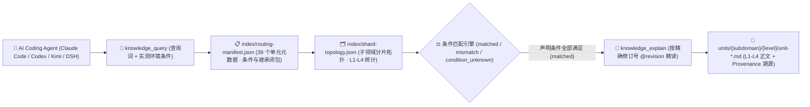

<p align="center">
  
</p>

<h1 align="center">MindIE Agent Knowledge — 分布式推理与集合通信知识库 (<code>knowledge-infer-distributed</code>)</h1>

<p align="center">
  <strong>面向昇腾多机多卡分布式推理与集合通信的 L1–L4 分级工程知识库：覆盖 HCCL 通信、RoCE/HCCS 拓扑与 Ranktable、DP/TP/EP/CP/PP 多维并行与 SHMEM 对称内存</strong>
</p>

<p align="center">
  <a href="https://github.com/mindie-agent/mindie-agent"></a>
  <a href="./publication-contract.json"></a>
  <a href="./publication-contract.json"></a>
  <a href="./index/routing-manifest.json"></a>
  <a href="./index/shard-topology.json"></a>
</p>

<p align="center">
  <strong>中文</strong> · <a href="./README.en.md">English</a> · <a href="#-一句话接入与检索">⚡ 一句话接入</a> · <a href="#️-领域全景与-l1l4-分级架构">🏗️ 分级架构</a> · <a href="#-子领域分布与代表性知识单元">📊 语料全景</a> · <a href="#-仓库结构与隐私质量门禁">🛡️ 结构与门禁</a>
</p>

---

## ⚡ 一句话接入与检索

你不需要手动克隆或配置索引。在 **Claude Code**、**OpenAI Codex CLI**、**Kimi Code** 或 **DeepSeek Harness (DSH)** 中，直接复制并发送下面这句话给你的 AI Agent：

```text
帮我安装一下这个 https://github.com/mindie-agent/mindie-agent
```

宿主插件就绪后会自动连接 [`mindie-knowledge`](https://github.com/mindie-agent/knowledge) 本地运行时，按需同步本仓库（`--domain infer-distributed`）并在本地构建毫秒级确定性检索索引。只读检索与全文读取**完全在本地执行，不消耗大模型 Token，也不要求开启社区共享**。

<details>
<summary>🤖 <b>AI Agent 自动安装与知识检索协议（点击展开 / Agent 读取本页时可直接解析执行）</b></summary>

> **给 AI Agent 的执行指南**：
>
> #### 1. 一键安装宿主插件
> 若当前宿主尚未安装 MindIE Agent，请先读取主仓库 [`https://github.com/mindie-agent/mindie-agent`](https://github.com/mindie-agent/mindie-agent) 的安装协议完成对应宿主插件注册。
>
> #### 2. 命令行同步与检查 `infer-distributed` 领域语料
> ```bash
> # 同步 infer-distributed 领域最新经校验的公开知识源（零模型调用）
> mindie-knowledge sync --domain infer-distributed
>
> # 查看本地知识索引状态与脱敏规则版本
> mindie-knowledge status --domain infer-distributed
> python3 -m mindie_knowledge.redact --profile
> ```
>
> #### 3. MCP 工具检索、精确全文读取与版本化反馈
> 在解决 `infer-distributed` 相关工程任务时，遵循 **先按实测条件检索 (`knowledge_query`) → 再按精确修订号读全文 (`knowledge_explain`) → 验证后可选反馈 (`knowledge_feedback`)** 的标准工作流：
>
> ```python
> # Step 1: 仅传入当前任务真实观测到的环境/版本条件（严禁猜测或抄写未观测条件）
> knowledge_query(
>     query="HCCL EI0006 notify wait timeout HCCN link triage",
>     conditions={
>         "soc": "Ascend910B4"
>     },
> )
>
> # Step 2: 使用返回的精确修订引用 (@revision) 读取完整正文、前置条件与继承闭包
> knowledge_explain(
>     ref="mindie://infer-distributed/units/unit-ascend-hccl-notify-wait-timeout-and-hccn-link-triage-sop@1",
> )
>
> # Step 3: 实机验证有效后，针对实际观测过的修订号记录本地有用性反馈（可选）
> knowledge_feedback(
>     ref="mindie://infer-distributed/units/unit-ascend-hccl-notify-wait-timeout-and-hccn-link-triage-sop@1",
>     rating="up",
>     reason="Separated rank skew from HCCN physical link degradation during EI0006 timeout triage.",
> )
> ```

</details>

---

## 🏗️ 领域全景与 L1–L4 分级架构

本仓库承载 MindIE Agent 的 **`infer-distributed` 领域分级知识源**（共 **39 个分级知识单元**：`L1: 3`、`L2: 21`、`L3: 13`、`L4: 2`）。聚焦昇腾 Atlas A2 / A3 / A5 集群上的 HCCL 集合通信机制、RoCE / HCCS 物理拓扑与 Ranktable 校验、EI0006/EI0002 Notify-Wait 超时与次生超时根因定位、HCCL AICPU 自定义集合通信算法与代价模型校准、多机 MoE EP（All2All / MC2）收敛、PD 分离非对称 TP KV 传输、多维混合并行（TP/DP/EP/CP/SP/PP）以及 CANN SHMEM 低时延跨卡内存直通访问。

### 1. `mindie-graded-unit/1` 四级知识单元体系（L1–L4）

本知识库拒绝碎片化的聊天摘要或脱离前提的“万能经验”，所有知识单元均按工程抽象粒度与可操作性划分为 **L1–L4 四个层级**（当前分布：**L1: 3 · L2: 21 · L3: 13 · L4: 2**）：

| 层级 | 标准类别 (`category`) | 工程定位 | 核心内容与准入要求 |
| :---: | --- | --- | --- |
| **L1** | `canonical-fact` (`axiom` / `measurement`) | **事实与约束标准** | 硬件微架构规格（UB/L1/HBM 对齐、双 Die 拓扑）、框架核心不变量、ABI 注册规则与四视图 Roofline 测量基线。常作为上层单元的继承前提（`parents`）。 |
| **L2** | `sop` | **标准排障与开发规程** | 确定性的分步诊断、算子开发、图编译护栏排查与精度比对标准作业程序（SOP），明确列出观测指标、判别分支与验证命令。 |
| **L3** | `workflow` | **多阶段工程工作流** | 端到端多阶段闭环工作流（如 0-day 模型适配、TTFT/TPOT 性能瓶颈收敛、分布式死锁根因定位、留一法消融实验）。 |
| **L4** | `optimization-pattern` (`mutator`) | **深度调优模式** | 经过实测验证的 Kernel / 计算图 / 通信并行代码变换模式（Mutator），附带严格的适用条件（`conditions`）、消融前后性能包络与源码溯源（`provenance`）。 |

### 2. 条件化路由与精确全文检索架构



> [!IMPORTANT]
> **严格条件匹配原则（No Silent Guesswork）**：查询时，`mindie-knowledge` 会将任务真实观测到的 `conditions` 与知识单元声明的适用前提逐项比对。只有所有声明条件均满足时才判定为 `matched`；缺失或未知的条件判定为 `condition_unknown` 并默认过滤，避免将特定硬件型号或特定源码提交下的结论误用于不兼容环境。

---

## 📊 子领域分布与代表性知识单元

[`index/routing-manifest.json`](./index/routing-manifest.json) 与 [`index/shard-topology.json`](./index/shard-topology.json) 是由全量 Markdown 单元派生的权威实时清单。当前仓库共包含 **39 个分级知识单元**（**L1: 3 · L2: 21 · L3: 13 · L4: 2**）：

### 1. 子领域（Subdomain）分布统计

| 子领域目录 | 单元数量 | 层级分布 (`L1–L4`) | 核心覆盖范围 |
| --- | :---: | :---: | --- |
| `hccl` | **12** | `L1: 1, L2: 6, L3: 4, L4: 1` | HCCL RoCE/HCCS 拓扑与 Ranktable 公理、通信域构造与 `HCCL_BUFFSIZE` 预算、EI0006/EI0002 超时与次生超时排障、HCCL-VM 校验器、`hccl-test` MPICH 压测/PFC-ECN 排障及 AICPU 集合通信算子开发与代价模型校准 |
| `parallelism` | **6** | `L1: 1, L2: 2, L3: 3` | 多维混合并行（TP/DP/EP/CP/SP/PP）张量切分公理、推理模块级并行线性层与 MoE 接线 SOP、MindSpeed TP-2D/DualPipeV、TorchTitan 5D DeviceMesh/DSA-CP，以及 MindIE-SD/vLLM-Omni DiT 通信掩盖、USP Ulysses/CFG 与功耗降频治理 |
| `shmem` | **6** | `L1: 1, L2: 3, L3: 1, L4: 1` | Ascend SHMEM PGAS 对称堆寻址与 Team 层次公理、Device 侧 RMA (MTE vs SDMA) 传输、DeepSeek-V4 对称窗口缓冲区与 Host DDR KVCache/HIXL 卸载 SOP、跨 PE Signal-Wait 死锁排障工作流及低时延 MoE Dispatch/Combine 双缓冲 Mutator |
| `serving` | **5** | `L2: 3, L3: 2` | 多机 MoE EP MC2/All2All 收敛工作流、模块解耦 TP/EP/DP/CP/KVP 并行策略、PD 分离非对称 P-TP/D-TP KV 头切分与分布式分片控制错误聚合 |
| `mooncake` | **4** | `L2: 3, L3: 1` | Mooncake Ascend Direct (ADXL/HIXL) 端口与超时预算、Transfer Engine 零拷贝段内存注册与 P2P 握手、两阶段 Put 租约 TTL 驱逐及 Etcd OpLog 主备切换工作流 |
| `dynamo` | **3** | `L2: 2, L3: 1` | Dynamo PD 分离服务发现与引导交接工作流、KV 感知路由 Radix 前缀重叠代价选择及队列反压（HTTP 529）/在途解码取消预算规程 |
| `vllm-ascend` | **3** | `L2: 2, L3: 1` | `vLLM-Ascend` 多机 Ray 集群 NPU 资源注册与 HCCN 预检、动态分块流水线并行（DCPP）二次时延预测器校准及 Mooncake Layerwise/Store PD 分离工作流 |

### 2. 代表性分级知识单元（Representative Units）

| 知识单元 ID（点击查看原文） | 子领域 | 层级 / 类别 | 工程主题与摘要 | 固定修订引用 (`ref`) |
| --- | :---: | :---: | --- | --- |
| [`unit-ascend-hccl-roce-hccs-topology-and-ranktable-axioms`](./hccl/topology/unit-ascend-hccl-roce-hccs-topology-and-ranktable-axioms.md) | `hccl` | **L1** / `axiom` | Ascend HCCL transport and rank-table axioms across A2, A3 and A5 | `mindie://infer-distributed/units/unit-ascend-hccl-roce-hccs-topology-and-ranktable-axioms@1` |
| [`unit-ascend-hybrid-tp-dp-ep-cp-sp-dimensional-partition-axioms`](./parallelism/hybrid-strategies/tp-dp-ep-cp-sp/unit-ascend-hybrid-tp-dp-ep-cp-sp-dimensional-partition-axioms.md) | `parallelism` | **L1** / `axiom` | Ascend Multi-Dimensional Parallelism (TP, DP, EP, CP, SP, PP) Tensor Partitioning and Communication Axioms | `mindie://infer-distributed/units/unit-ascend-hybrid-tp-dp-ep-cp-sp-dimensional-partition-axioms@1` |
| [`unit-ascend-shmem-symmetric-heap-addressing-and-team-axioms`](./shmem/symmetric-memory/architecture-and-apis/unit-ascend-shmem-symmetric-heap-addressing-and-team-axioms.md) | `shmem` | **L1** / `axiom` | Ascend SHMEM PGAS Symmetric Heap Addressing, UID Bootstrap, and Team Hierarchy Axioms | `mindie://infer-distributed/units/unit-ascend-shmem-symmetric-heap-addressing-and-team-axioms@1` |
| [`unit-ascend-hccl-notify-wait-timeout-and-hccn-link-triage-sop`](./hccl/triage/unit-ascend-hccl-notify-wait-timeout-and-hccn-link-triage-sop.md) | `hccl` | **L2** / `sop` | Triage EI0006/EI0002 notify-wait timeouts: separate rank skew from HCCN link degradation | `mindie://infer-distributed/units/unit-ascend-hccl-notify-wait-timeout-and-hccn-link-triage-sop@1` |
| [`unit-ascend-hccl-comm-group-construction-and-buffsize-rdma-sop`](./hccl/topology-and-network/roce-hccs-diagnostics/unit-ascend-hccl-comm-group-construction-and-buffsize-rdma-sop.md) | `hccl` | **L2** / `sop` | Ascend HCCL Communicator Group Construction, HCCL_BUFFSIZE Sizing, and PD KV-Transfer RDMA Budget SOP | `mindie://infer-distributed/units/unit-ascend-hccl-comm-group-construction-and-buffsize-rdma-sop@1` |
| [`unit-pd-disaggregated-kv-connector-and-asymmetric-tp-sop`](./serving/pd-disaggregation/unit-pd-disaggregated-kv-connector-and-asymmetric-tp-sop.md) | `serving` | **L2** / `sop` | PD-disaggregated KV connector and asymmetric P-TP/D-TP KV-head slicing | `mindie://infer-distributed/units/unit-pd-disaggregated-kv-connector-and-asymmetric-tp-sop@1` |
| [`unit-ascend-shmem-device-rma-mte-and-sdma-data-movement-sop`](./shmem/symmetric-memory/architecture-and-apis/unit-ascend-shmem-device-rma-mte-and-sdma-data-movement-sop.md) | `shmem` | **L2** / `sop` | Ascend SHMEM Device-Side RMA (MTE vs SDMA) and Put-With-Signal Data Movement SOP | `mindie://infer-distributed/units/unit-ascend-shmem-device-rma-mte-and-sdma-data-movement-sop@1` |
| [`unit-ascend-hccl-secondary-timeout-and-in-kernel-mc2-sync-workflow`](./hccl/topology-and-network/roce-hccs-diagnostics/unit-ascend-hccl-secondary-timeout-and-in-kernel-mc2-sync-workflow.md) | `hccl` | **L3** / `workflow` | Ascend HCCL Secondary Timeout Root-Rank Triage, AIV Op-Expansion Starvation, and In-Kernel HcclComm Workflow | `mindie://infer-distributed/units/unit-ascend-hccl-secondary-timeout-and-in-kernel-mc2-sync-workflow@1` |
| [`unit-multi-node-moe-ep-mc2-all2all-convergence-workflow`](./serving/moe-ep/unit-multi-node-moe-ep-mc2-all2all-convergence-workflow.md) | `serving` | **L3** / `workflow` | Bring up and converge multi-node MoE EP with MC2 dispatch/combine and All2All | `mindie://infer-distributed/units/unit-multi-node-moe-ep-mc2-all2all-convergence-workflow@1` |
| [`unit-ascend-module-decoupled-tp-ep-cp-kvp-parallel-workflow`](./serving/parallel-strategy/unit-ascend-module-decoupled-tp-ep-cp-kvp-parallel-workflow.md) | `serving` | **L3** / `workflow` | Module-decoupled TP/EP/DP/CP/KVP parallel strategy sizing, CommManager physical group reuse, and packed TND padding workflow | `mindie://infer-distributed/units/unit-ascend-module-decoupled-tp-ep-cp-kvp-parallel-workflow@1` |
| [`unit-hccl-aicpu-cost-model-calibration-and-hvm-estimate-mutator`](./hccl/aicpu-collectives/debug-and-perf-tuning/unit-hccl-aicpu-cost-model-calibration-and-hvm-estimate-mutator.md) | `hccl` | **L4** / `mutator` | HCCL AICPU Cost-Model α-β-γ Calibration, HVM Trace Profiling, and Selector Threshold Mutator | `mindie://infer-distributed/units/unit-hccl-aicpu-cost-model-calibration-and-hvm-estimate-mutator@1` |
| [`unit-ascend-shmem-low-latency-moe-cross-rank-dispatch-combine-mutator`](./shmem/symmetric-memory/sync-and-moe-dispatch/unit-ascend-shmem-low-latency-moe-cross-rank-dispatch-combine-mutator.md) | `shmem` | **L4** / `mutator` | Ascend SHMEM Low-Latency MoE Cross-Rank Token Dispatch/Combine and Double-Buffer Mutator | `mindie://infer-distributed/units/unit-ascend-shmem-low-latency-moe-cross-rank-dispatch-combine-mutator@1` |
| [`unit-mindie-sd-usp-cfg-fa-power-cap-eplb-and-yuanrong-sop`](./parallelism/mindie-sd-and-omni/collectives-and-connectors/unit-mindie-sd-usp-cfg-fa-power-cap-eplb-and-yuanrong-sop.md) | `parallelism` | **L2** / `sop` | MindIE-SD & vllm-omni Ulysses/Ring/CFG hybrid sequence parallelism, FA+AllToAll power-cap mitigation, EPLB, and YuanrongConnector SOP | `mindie://infer-distributed/units/unit-mindie-sd-usp-cfg-fa-power-cap-eplb-and-yuanrong-sop@1` |
| [`unit-mindie-sd-dit-parallel-comm-masking-and-fewstep-probe-workflow`](./parallelism/mindie-sd-and-omni/workflows/unit-mindie-sd-dit-parallel-comm-masking-and-fewstep-probe-workflow.md) | `parallelism` | **L3** / `workflow` | MindIE-SD DiT-only few-step multirank probe, c/f communication-masking bound, and scaling convergence workflow | `mindie://infer-distributed/units/unit-mindie-sd-dit-parallel-comm-masking-and-fewstep-probe-workflow@1` |

---

## 🛡️ 仓库结构与隐私质量门禁

### 1. 仓库目录结构

```text
knowledge-infer-distributed/
├── publication-contract.json           # 发布契约 (mindie-publication-contract/2) 与固定 Validator 修订号
├── AGENTS.md                           # 维护者与 AI Agent 仓库操作边界规范
├── README.md                           # 中文主文档
├── README.en.md                        # 英文主文档 (English Documentation)
├── LICENSE                             # 双许可声明 (CC BY 4.0 语料与文档 + MIT 维护脚本)
├── index/
│   ├── routing-manifest.json           # [派生索引] 全量单元 ID、路径、层级、条件、继承闭包与 Token 估算
│   └── shard-topology.json             # [派生索引] 子领域分片计数与层级拓扑
├── <subdomain>/.../unit-*.md           # [核心语料] L1–L4 分级知识单元 Markdown 正文与 YAML Frontmatter
└── docs/
    └── evidence/                       # 源码审计收据、实验消融数据与溯源证据
```

### 2. 双层隐私脱敏与确定性 CI 发布门禁（`.github/workflows/check.yml`）

本仓库作为公开工程知识源，在本地构建与 GitHub Actions CI（`check.yml`）中强制执行**零信任数据校验与双层隐私脱敏门禁**：

1. **不可变契约与纯数据校验（`publication_check.validate`）**：
   - CI 从可信基准读取 [`publication-contract.json`](./publication-contract.json)，安装精确固定提交的 `mindie-knowledge` 校验器；
   - 所有候选文件仅作为 Git 数据对象（`git cat-file --batch`）流式读取，**绝不在 CI 中执行任何候选代码**；
   - 严格校验每个 `unit-*.md` 的 Schema（`mindie-graded-unit/1`）、路径与稳定 ID 一致性、修订号与 SHA-256 内容摘要、父子继承有向无环图（DAG），以及 `index/routing-manifest.json` 和 `index/shard-topology.json` 与实际单元的 100% 一致性。
2. **双层闭锁式隐私扫描（Gitleaks + `mindie_knowledge.redact` `r3`）**：
   - 全仓所有文本文件、知识单元 Frontmatter/正文、公开反馈及 PR 标题/描述均经过确定性隐私扫描；
   - **严禁包含**任何本地宿主绝对路径（如个人主目录、挂载卷路径）、私有内网 IPv4/IPv6 地址段、SSH 登录凭据、API 密钥或内部机器名，一旦命中立即阻断合入。

---

## 🔗 关联仓库与生态导航

- **主仓库与一键安装入口**：[`mindie-agent/mindie-agent`](https://github.com/mindie-agent/mindie-agent)
- **知识检索与隐私脱敏运行时**：[`mindie-agent/knowledge`](https://github.com/mindie-agent/knowledge)（Python 包 `mindie-knowledge`）
- **七大公开领域知识库矩阵**：
  - [`knowledge-vllm-ascend`](https://github.com/mindie-agent/knowledge-vllm-ascend) — `vLLM-Ascend` 与 `vLLM-Omni` 适配、图编译、MoE、PD 分离与多阶段全模态流水线（91 Units）
  - [`knowledge-operators`](https://github.com/mindie-agent/knowledge-operators) — AscendC / BiShengIR / Triton / TileLang / MindIE-SD 算子开发与优化（105 Units）
  - [`knowledge-infer-core`](https://github.com/mindie-agent/knowledge-infer-core) — 核心推理引擎调度、KV Cache、`MindIE-SD` 扩散加速与服务化架构（109 Units）
  - [`knowledge-infer-distributed`](https://github.com/mindie-agent/knowledge-infer-distributed) — HCCL 集合通信、RoCE/HCCS 拓扑、Ulysses/Ring/CFG 混合并行与 SHMEM（39 Units）
  - [`knowledge-infer-observability`](https://github.com/mindie-agent/knowledge-infer-observability) — CANN 故障诊断、`msprof` 性能剖析与 A/B/A 性能/精度门禁（39 Units）
  - [`knowledge-infer-ops-compat`](https://github.com/mindie-agent/knowledge-infer-ops-compat) — GE/TorchAir/Inductor 图编译、自定义算子注册与两阶段框架集成（34 Units）
  - [`knowledge-agent-engineering`](https://github.com/mindie-agent/knowledge-agent-engineering) — 智能体编排、S0–S6 自动调优工作流、脱敏审计与基准评测（33 Units）

---

## 📄 开源许可（License）

本仓库遵循 [`LICENSE`](./LICENSE) 双许可声明（与 `mindie-publication-contract/2` 仓库结构对齐）：

- **知识语料、派生索引、公开反馈与文档证据**（`<domain_path>/unit-*.md`、`index/`、`feedback/`、`README.md`、`README.en.md`、`AGENTS.md`、`docs/`）采用 **[Creative Commons Attribution 4.0 International (CC BY 4.0)](./LICENSE)** 许可协议。
- **仓库维护脚本与工作流配置**（`scripts/`、`.github/workflows/`、`publication-contract.json`）采用 **[MIT License](./LICENSE)** 许可协议。
